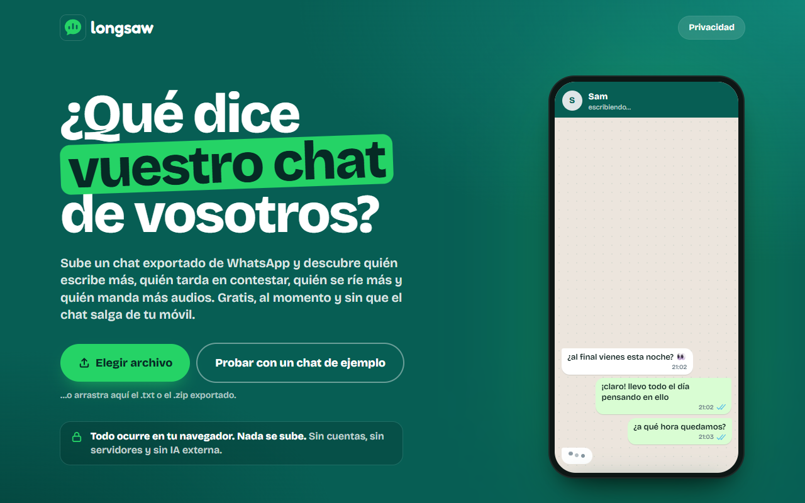
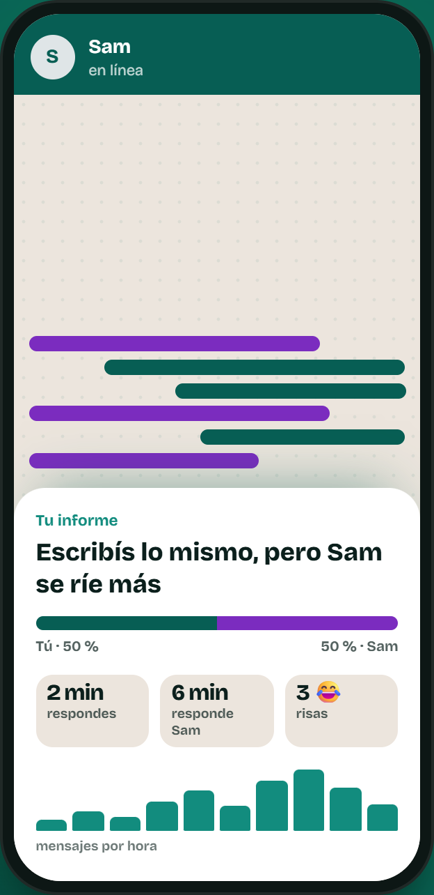
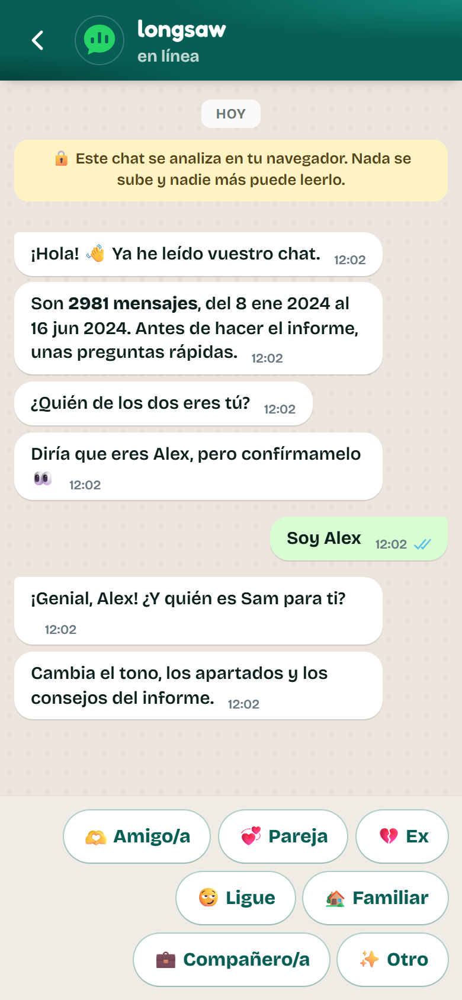
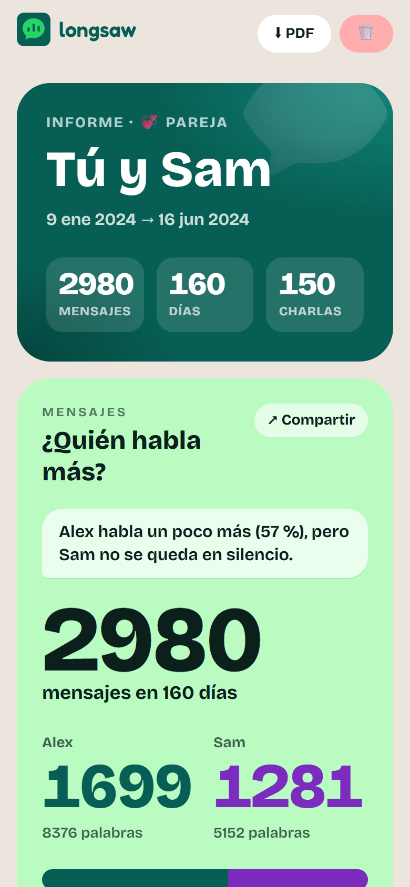
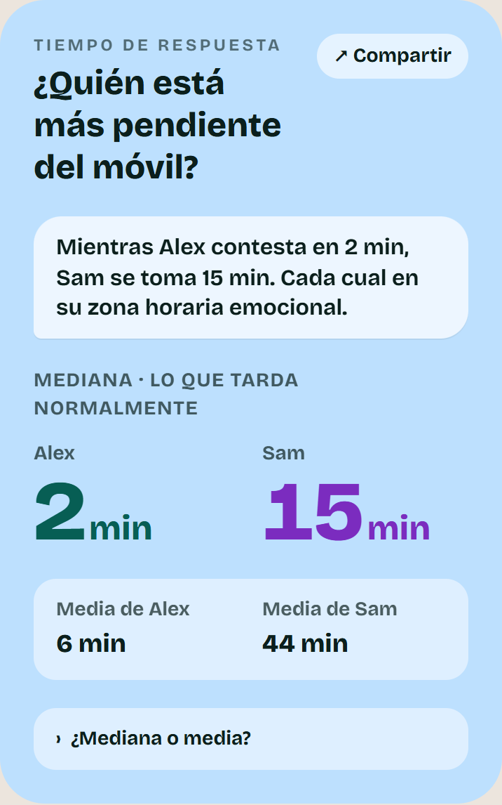
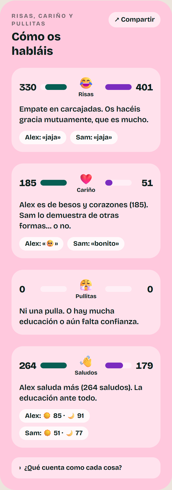
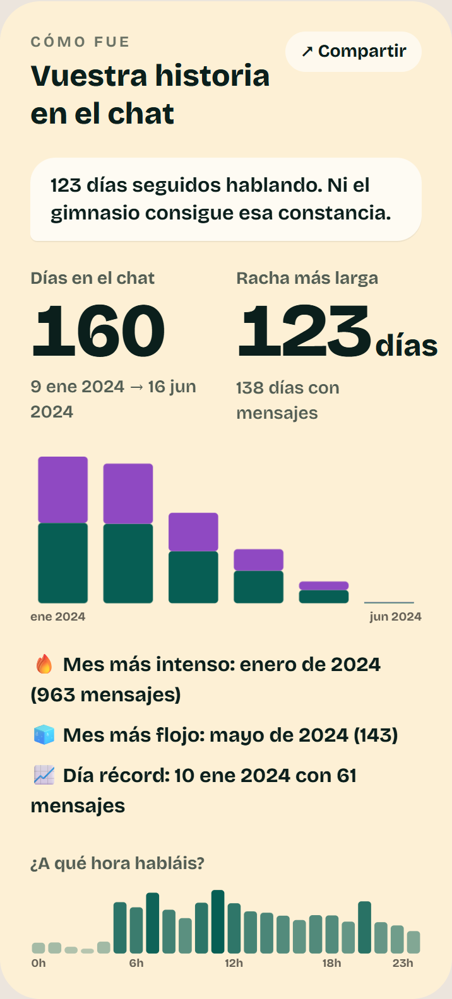

<p align="center">
  <picture>
    <source media="(prefers-color-scheme: dark)" srcset="docs/brand/logo-dark.png">
    
  </picture>
</p>

<h3 align="center">¿Qué dice vuestro chat de vosotros?</h3>

<p align="center">
  Sube un chat de WhatsApp y descubre quién escribe más, quién tarda en contestar,<br>
  quién se ríe más y quién manda más audios. Gratis, sin cuentas y sin que el chat salga de tu navegador.
</p>

<p align="center">
  <a href="https://iagoesteevezz.github.io/longsaw/"><b>👉 Pruébala ahora en el navegador</b></a>
  <br>
  <sub>No hace falta instalar nada. ¿No quieres usar un chat tuyo? Pulsa <b>«Probar con un chat de ejemplo»</b>.</sub>
</p>

<p align="center">
  <a href="https://iagoesteevezz.github.io/longsaw/"></a>
</p>

## Cómo funciona

Tres pasos, menos de un minuto:

<table>
  <tr>
    <td align="center" width="33%"></td>
    <td align="center" width="33%"></td>
    <td align="center" width="33%"></td>
  </tr>
  <tr>
    <td valign="top"><b>1. Suelta tu chat.</b><br>Exporta la conversación desde WhatsApp y arrástrala a la web. Se lee al momento.</td>
    <td valign="top"><b>2. Responde unas preguntas.</b><br>Como en un chat: quién eres, quién es la otra persona para ti y cómo quieres llamarla.</td>
    <td valign="top"><b>3. Disfruta del informe.</b><br>18 tarjetas con números exactos y comentarios con algo de mala leche (y cariño).</td>
  </tr>
</table>

## 18 tarjetas sobre vosotros

<table>
  <tr>
    <td align="center" width="33%"></td>
    <td align="center" width="33%"></td>
    <td align="center" width="33%"></td>
  </tr>
</table>

- **Quién habla más** y quién escribe primero.
- **Tiempo de respuesta**, con la mediana (lo que tardas normalmente) y la media.
- **Fotos, audios, vídeos y stickers** de cada persona.
- **Risas, cariño y pullitas**: cuántas, de quién y con qué estilo (*jaja*, *jsjs*, *xd*…).
- **Vuestra historia**: rachas, meses más intensos y a qué hora habláis.
- **Vistos, silencios largos y mensajes borrados.**
- **Vuestras palabras**: las favoritas de cada uno y las que repetís los dos.
- **Nivel de interés, red flags, estilo de cada uno, «lo que quiere decir» y «y ahora, ¿qué?».**

Cada tarjeta se puede **compartir como imagen**, y el informe completo se descarga en **PDF**. Al compartir, los nombres se cambian por «Persona A» y «Persona B» por defecto.

## Tu chat no sale de tu móvil

- **Se analiza en tu navegador.** No hay servidor que reciba el chat. Puedes comprobarlo en la pestaña «Red» de las herramientas del navegador: no sale ninguna petición.
- **Sin IA externa, sin cuentas y sin analíticas.** Los comentarios salen de un banco de unas 190 frases elegidas según vuestros datos.
- **No se guarda nada**, salvo que tú lo pidas, y entonces solo en tu dispositivo. El botón «Borrar todo» lo elimina.
- **Gratis y de código abierto.** Todo lo que hace la web está en este repositorio.

## Cómo exportar un chat de WhatsApp

- **iPhone**: abre el chat → toca el nombre del contacto → Exportar chat → **Sin archivos**. Se genera un `.zip`.
- **Android**: abre el chat → ⋮ → Más → Exportar chat → **Sin archivos**. Se genera un `.txt`.

Elige siempre *sin archivos*: es más rápido y las fotos, audios y stickers se cuentan igual a partir de los avisos «imagen omitida», «audio omitido»…

## Preguntas rápidas

<details>
<summary><b>¿Funciona con grupos?</b></summary>

De momento no: solo chats entre dos personas.
</details>

<details>
<summary><b>¿En qué idiomas?</b></summary>

La web y el informe están en español y en inglés: se elige solo según el idioma de tu sistema y puedes cambiarlo con el botón ES/EN. Lee exports de WhatsApp en español e inglés, de iPhone y Android, con cualquier formato de fecha y hora. Los avisos de multimedia se reconocen también en portugués, francés, alemán e italiano.
</details>

<details>
<summary><b>¿Por qué en Android sale «multimedia sin especificar»?</b></summary>

Porque Android escribe lo mismo («&lt;Multimedia omitido&gt;») para fotos, audios y vídeos. Se cuentan, pero no se puede saber de qué tipo eran. En iPhone sí se distinguen.
</details>

<details>
<summary><b>¿Es un análisis psicológico?</b></summary>

No. Son números de vuestro chat y comentarios para pasar un buen rato, no un diagnóstico.
</details>

---

<details>
<summary><b>Para desarrolladores: ejecutarla en local, tests y despliegue</b></summary>

### Arrancar

Necesitas Node 22 o superior.

```bash
npm install
npm run dev            # http://localhost:5173
```

No hay variables de entorno ni backend.

### Tests

```bash
npm test               # parser, estadísticas, multimedia, diccionarios, frases, privacidad, PDF, anonimizador
npm run typecheck
npm run build          # compila TypeScript y genera dist/
```

Los exports de prueba de cada formato están en `tests/fixtures/`: iOS y Android, 12 y 24 h, «p. m.», U+202F, CRLF con BOM, fechas con puntos o ISO, grupos, una sola persona y teléfonos con marcas bidi. Todos son inventados y también sirven para subirlos a mano en la web.

> **No subas chats reales al repositorio.** Guárdalos en `chats/` o `private/`, que están en `.gitignore` igual que los `.zip` y los `.txt` de la raíz.

### Despliegue

- **GitHub Pages**: [`.github/workflows/pages.yml`](.github/workflows/pages.yml) pasa los tests y publica la web en cada push a `main`. Hay que activarlo una vez en *Settings → Pages → Source: GitHub Actions*.
- **Cloudflare Pages o Netlify**: sirve `dist/` tal cual. `public/_headers` añade una CSP estricta (GitHub Pages no admite cabeceras propias).

```bash
npm run build && npm run preview   # prueba en local la versión de producción
```

### Cómo está hecha

React, TypeScript, Vite y Tailwind. El chat se procesa en un Web Worker y nunca sale de él. Arquitectura, decisiones, métricas y riesgos: [`docs/ARCHITECTURE.md`](docs/ARCHITECTURE.md).

</details>

## Licencia

[MIT](LICENSE). longsaw no está afiliado a WhatsApp.
